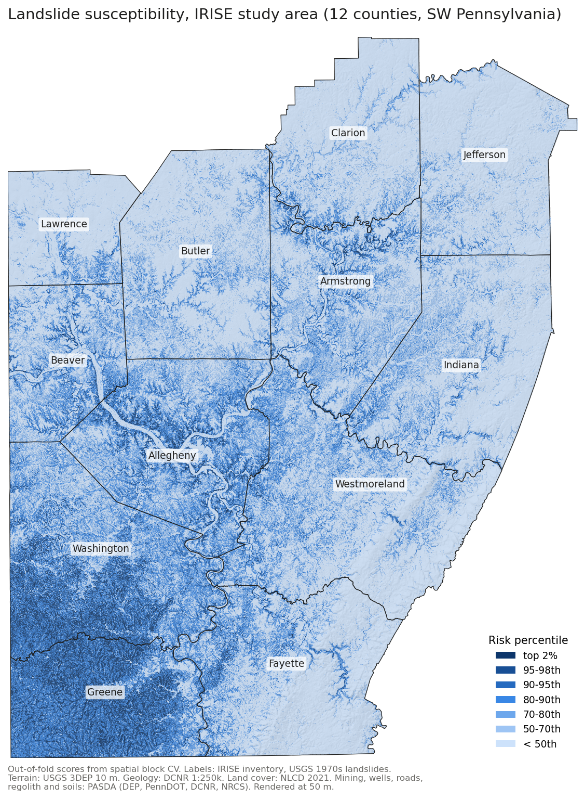
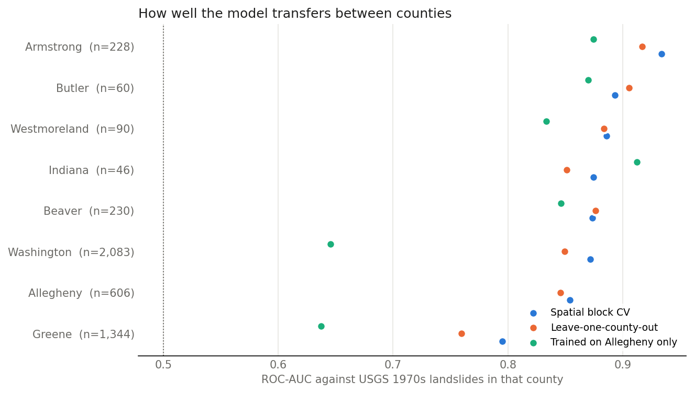

# SW Pennsylvania Landslide Susceptibility Model (IRISE study area)

Regional extension of an Allegheny County pilot model to the 12 counties of PennDOT
Districts 10, 11 and 12 (21,500 km², 1.44 million H3 hexagons), trained on the
[IRISE Regional Landslide Inventory](https://data.wprdc.org/dataset/irise-regional-landslide-inventory-for-southwestern-pennsylvania)
with added predictors and test records from [PASDA](https://www.pasda.psu.edu/).



## Quick start

```bash
python3 -m venv --system-site-packages .venv && .venv/bin/pip install -r requirements.txt
.venv/bin/python run.py          # fetch -> features -> train -> maps
.venv/bin/python ablation.py        # optional: which PASDA layers help on held-out Allegheny
.venv/bin/python aef_experiment.py  # optional: AlphaEarth foundation-model embeddings (~1.7 GB download)
```

A cold run downloads about 3.3 GB (2.7 GB of 10 m DEM tiles, 0.6 GB from PASDA) and takes about 1.5 hours:
~30 min of downloads, ~2 min of terrain and ~15 s of PASDA processing per county, ~30 min of training.
Everything is cached, so `run.py train` alone reruns in about 30 minutes. PASDA file names carry a month
stamp (e.g. `2026_09`); if a download 404s, update the names in `swpa/pasda.py`.

## Design

| | Allegheny model | This model |
|---|---|---|
| Area | 1 county, 128k cells | 12 counties, 1.44M cells |
| Training label | Pomeroy and Davies (1975, USGS MF-685B) recent-landslide polygons | IRISE `USGS` points: 1970s air-photo mapping digitized by SPC and Pitt (4,844 points, 4,727 positive cells) |
| Independent test | 311 reports (city only) | IRISE 311, County DPW, City, Pitt and Forest Hills records, plus PASDA's County Public Works 2025 and FEMA 2018 assistance sites (824 Allegheny cells) |
| Geology | 5 units | 11 units, including Greene, Washington, Pottsville and Mauch Chunk; smaller units pooled as `geo_other` |
| Extra predictors | none | Undermining (PASDA / PA DEP); other PASDA layers tested, see below |
| Processing | Whole county at once | County by county with a 2 km buffer, then merged (border hexagons keep the larger piece) |
| Extra validation | Spatial block CV | + leave-one-county-out, + "trained on Allegheny only" transfer, + Allegheny-holdout ablation |

Terrain features, H3 resolution, LightGBM settings and the slope-only baseline are the same as before. For
speed, training uses all positives plus a random 25% of negatives; that does not change rankings.

The IRISE NASA records (Global Landslide Catalog) are kept out of both training and testing because many
of their locations are only accurate to kilometers. The Adams (1986) and Ackenheil (1920 to 1954) records
are also kept aside. The PennDOT district records described in the IRISE report are not in the public release.

### PASDA predictors and the 1975 rule

The labels are slides visible on ~1973 air photos, so a predictor may only describe conditions that existed
by then. Otherwise the model learns coincidence: 92% of longwall panels and every unconventional gas well
post-date the labels, but they cluster in Greene and Washington, where the mapped slides also cluster.
The model therefore uses `longwall_pre1976` and `well_density_pre1976` (spud date by 1975, or undated). The
all-dates versions stay in the cell table for reference only.

| Group | Features | Source (PASDA id) |
|---|---|---|
| Mining (**in primary model**) | `mined`, `dist_mined`, `ug_permit`, `longwall_pre1976` | DEP Digitized Mined Areas (257), Historic Underground Mine Permits (366), Longwall Panels (256) |
| Wells | `well_density_pre1976` (wells/km² within 500 m) | DEP Oil & Gas Locations (1088) |
| Roads | `road`, `dist_road`, `dist_state_road` | PennDOT State and Local Roads (54) |
| Regolith | `regolith_m` = DEM minus bedrock surface | DCNR Bedrock Surface Topography (316) |
| Soils | depth to bedrock and water table, hydrologic group, drainage, clay, Ksat, shrink-swell, share of high soil-slip potential | NRCS SSURGO county surveys |

## Results

### Which PASDA layers help? (`ablation.py`)

Train on the other 11 counties, score Allegheny, average of 3 seeds. The modern column is the one that
matters: those slides are independent of the training labels.

| Added to terrain + geology + land cover | USGS 1970s slides | Modern slides | Modern, near roads |
|---|---|---|---|
| Nothing (baseline) | 0.839 | 0.766 | 0.763 |
| **+ mining** | **0.845** | **0.777** | **0.772** |
| + wells | 0.838 | 0.765 | 0.763 |
| + regolith | 0.838 | 0.762 | 0.759 |
| + soil-slip rating | 0.838 | 0.759 | 0.757 |
| + roads | 0.841 | 0.750 | 0.744 |
| + other soil properties | 0.832 | 0.745 | 0.742 |
| + all PASDA | 0.840 | 0.743 | 0.739 |

Only mining helps on new slides. Soils and roads fit the 1970s map slightly better in the main CV but
transfer worse. The likeliest reasons: soil surveys differ in vintage and map-unit concepts from county
to county, and the 1970s mappers could see slides along road cuts in rural counties in a way that doesn't
match Allegheny's urban road network. The soil-slip rating may also partly echo the same landslides the
USGS mapped. So the primary model is **terrain + geology + land cover + mining**, and the all-PASDA model
is kept as a comparison.

Mining acts in the expected direction. Cells inside historic underground-mine permits get about +0.27
log-odds versus -0.06 outside, and undermined cells have 2.3 times the rate of mapped slides (0.61% vs 0.26%).

### Main results

**Against USGS 1970s labels** (median of per-county ROC-AUC; pooled numbers in `metrics.json` run higher because
part of what the model learns is which counties have many mapped slides):

| Features | Spatial block CV | Leave-one-county-out |
|---|---|---|
| Slope only | 0.826 | |
| Terrain + geology + land cover | 0.870 | 0.857 |
| **+ mining (primary)** | **0.874** | **0.864** |
| + all PASDA | 0.881 | 0.871 |

**Independent test: modern landslide records in Allegheny County** (ROC-AUC over 127,889 cells, 824 with a record):

| Model | All cells | Cells within 30 m of a road |
|---|---|---|
| Slope only | 0.704 | 0.728 |
| Trained on Allegheny only, terrain + geology + land cover | 0.752 | 0.741 |
| Trained on Allegheny only, + mining | 0.764 | 0.753 |
| Regional, never saw Allegheny (leave-one-county-out), + mining | 0.777 | 0.773 |
| Regional, terrain + geology + land cover (block CV) | 0.787 | 0.777 |
| **Regional + mining (block CV, primary)** | **0.793** | **0.783** |
| Regional + all PASDA (block CV) | 0.784 | 0.771 |



What this says:

- **Expanding the training area helps.** On the same modern Allegheny records, the regional model beats a
  model trained on Allegheny alone (0.79 vs 0.76). Even a model that never saw a single Allegheny cell does
  better (0.78). All of these beat slope alone (0.70) by a clear margin.
- **Undermining adds a small, consistent gain.** It helps in every setting (+0.006 to +0.013). The effect is
  modest because most mining is concentrated in a few counties and mapped only at the permit or seam scale.
- **The road-restricted test changes little.** Scores are about the same whether or not the comparison is
  limited to street-side cells, where people report slides, so the modern-test result isn't just a
  reporting artifact.
- **It transfers between counties.** Leave-one-county-out stays within about 0.04 of block CV in every county
  with enough labels. An Allegheny-only model transfers poorly to Washington and Greene (0.65 and 0.64). Their
  Greene and Washington formation bedrock doesn't occur in Allegheny, so a model needs those counties in training.
- **Main drivers:** local relief, elevation and upper-tail slope, then geology (Glenshaw, Greene and Allegheny
  formations), roughness and forest cover. Underground-mine permits rank 13th of 45.
  See [feature importance](outputs/feature_importance.png).
- Clarion, Fayette, Jefferson and Lawrence have too few mapped slides (4 to 14 cells) to score.

Results from before the PASDA work are kept in `outputs/v1_before_pasda/`.

## Foundation-model embeddings: AlphaEarth (tested, not used)

`swpa/aef.py`, `aef_experiment.py` and `aef_pca.py` test whether a satellite foundation model helps. Google/DeepMind's
[AlphaEarth Foundations](https://source.coop/tge-labs/aef) embeddings compress a year of multi-sensor imagery into 64
numbers per 10 m pixel. We use the 2017 layer, the earliest available, read from the public COGs at 40 m
(about 9 pixels per hexagon) and averaged per cell. A later year could show scars from the 2018 landslides, so
the test also scores the 633 Allegheny cells with records dated 2018 or later, which 2017 imagery cannot have seen.

The embeddings are well aligned and informative. A linear fit on them recovers NLCD forest (R² 0.87), water (0.90)
and even mean slope (0.81) per hexagon. But they make landslide prediction worse:

| Allegheny holdout (train on 11 counties) | USGS 1970s | Modern | Modern, 2018+ | Near roads |
|---|---|---|---|---|
| **Primary (terrain + geology + land cover + mining)** | **0.845** | **0.777** | **0.781** | **0.772** |
| + AEF (64 dims) | 0.834 | 0.714 | 0.713 | 0.719 |
| AEF instead of land cover | 0.833 | 0.713 | 0.713 | 0.719 |
| + AEF, 8 principal components | | 0.749 | | |
| + AEF, 4 principal components | | 0.747 | | |
| Slope + AEF | 0.803 | 0.661 | 0.655 | 0.676 |
| AEF only | 0.785 | 0.593 | 0.585 | 0.615 |

In spatial block CV over all 12 counties, AEF *raises* the median within-county AUC against the 1970s labels
(0.874 to 0.887) while lowering the modern-slide score (0.793 to 0.775). That is the same pattern as soils and
roads: it fits the training map better and transfers worse. The embeddings describe surface appearance (farmland
mosaics, forest texture, settlement patterns), which in the training counties happens to track where the
1970s mappers found slides. That doesn't carry over to urban Allegheny, where slides happen on developed
hillsides. Landslide susceptibility is set mostly by terrain and rock, which imagery sees only indirectly, and
the hand-built terrain features already capture it more directly. The embeddings might earn a place in a
different design, such as detecting new disturbance year to year or training on modern labels, but not as
extra predictors here.

## Read this before using the map

- **Label density is uneven, and the model partly learns it.** The 1970s mapping has 2,083 positive cells in
  Washington but 14 in Fayette. PASDA's SPC polygons from the same survey show the same imbalance, so it comes
  from the original mapping. Some of it is real geology, and some is probably uneven mapping effort.
  Elevation ranks #2, partly as a proxy for "which part of the region", so the Laurel Highlands and northern
  counties may be under-rated.
- **Use `risk_pct_county` for local screening.** It ranks cells within their own county. `risk_pct` (used on
  the regional map) ranks across the whole region and pushes sparsely mapped counties toward pale.
- **Present-day mining and drilling are not in the score.** Post-1975 longwall mining and unconventional well
  pads are physically relevant now, but 1970s labels can't teach their effect. Overlay those layers
  separately rather than reading them into the risk surface.
- The modern test is almost entirely Allegheny. Nothing modern tests the other 11 counties.
- Flow routing stops at each county's 2 km buffer, so drainage area is truncated for large rivers entering
  from outside. This has little effect on hillslope-scale TWI and HAND.
- Static susceptibility only: no rainfall yet.

## Outputs (`outputs/`)

- `risk_map_region.png`, `per_county_auc.png`, `feature_importance.png`
- `risk_map_region.html`: interactive map (H3 res 8, upper 30%, county and label counts in tooltips)
- `risk_pct_10m_<county>.tif`: 10 m risk percentile per county (uint8, 1 to 100; 0 = nodata), for GIS
- `risk_pct_50m_region.tif`: regional mosaic at 50 m
- `cells_risk.parquet`: per-hexagon scores for every model and evaluation, plus `risk_pct` and `risk_pct_county`
- `metrics.json`, `per_county_metrics.csv`, `feature_importance.csv`, `ablation_allegheny_holdout.csv`,
  `aef_allegheny_holdout.csv`, `aef_block_cv.csv`,
  `model_plus_mining.txt`

## Next steps

1. **Modern labels outside Allegheny**: ask IRISE or PennDOT for the district slide lists. Every test of new
   slides is Allegheny-only right now, and that is the biggest gap.
2. **Rainfall climate**: PRISM 1991-2020 normals and extreme-day frequency (from Oregon State; PASDA's copies are
   older or cover only the Susquehanna basin).
3. **Mapping-effort correction**: restrict negatives to USGS-mapped quadrangles, or add a county/quadrangle
   offset, so the model separates geology from survey intensity.
4. **Soils, revisited**: harmonize SSURGO across survey areas (for example gSSURGO or POLARIS) and retest; the
   county-by-county surveys may be what fails to transfer.
5. **Present-day exposure layer**: combine the susceptibility score with post-1975 longwall panels, well pads and
   roads for a "where is it risky today" map, kept separate from the trained model.

## PASDA datasets reviewed (2026-09-27)

Record counts are for the study-area bounding box. REST base: `https://mapservices.pasda.psu.edu/server/rest/services/pasda/`.

| Dataset (PASDA id) | Layer | Count | Status |
|---|---|---|---|
| Digitized Mined Areas (257) | `DEP2/1` | 3,803 | **Used** (primary model) |
| Historic Underground Mine Permits (366) | `DEP2/3` | 1,494 | **Used** (primary model) |
| Longwall Mining Panels (256) | `DEP2/0` | 845 | **Used**, pre-1976 panels only (84 statewide) |
| Oil & Gas Locations, conv./unconv. (1088) | `DEP/22` | 89,837 | Tested; neutral |
| PA State Roads / Local Roads (54) | `PennDOT/4`, `PennDOT/3` | 28,726 / 164,206 | Tested; hurts transfer |
| Bedrock Surface Topography (316) | image service `DCNR_BedrockElevation` | 100 m raster | Tested; slightly negative |
| County SSURGO soils (891, 241, 484, 174, ...) | `Soils_PA` | 345k polygons | Tested; hurts transfer |
| Allegheny County Landslides, Public Works 2025 (3003) | `AlleghenyCounty/38` | 115 | **Used** as test records |
| Allegheny Landslide Individual / Public Assistance (3004, 3005) | `AlleghenyCounty/39`, `/40` | 36 / 86 | **Used** as test records |
| Allegheny County Retaining Walls 2006 (1220) | `AlleghenyCounty/5` | 10,688 | Not used (Allegheny only) |
| SPC Previously Active Landslides (1622) | `SPC/0` | 4,564 polygons | Not used; same survey as the IRISE points |

Checked and not useful here: USGS national inventory v3 (in this area it is only Pomeroy's Allegheny map,
already used, plus 92 West Virginia polygons); PAMAP 2006-08 lidar and the PSU TWI rasters (3DEP already carries
newer lidar and TWI is computed in-house); PASDA precipitation layers (1961-1990 PRISM or Susquehanna basin only).

## Data sources

Full credits, licenses, modifications and citations for every dataset are in [`DATA_SOURCES.md`](DATA_SOURCES.md).
In brief:

- [IRISE Regional Landslide Inventory](https://data.wprdc.org/dataset/irise-regional-landslide-inventory-for-southwestern-pennsylvania)
  (University of Pittsburgh, via WPRDC; CC BY-SA) and its
  [report](https://www.engineering.pitt.edu/contentassets/3d8715ebbb8746d4aa0daf5420880612/rba01-iriselandslidedatabaserep.pdf)
- [USGS 3DEP](https://elevation.nationalmap.gov/arcgis/rest/services/3DEPElevation/ImageServer) elevation and
  [USGS/MRLC NLCD 2021](https://doi.org/10.5066/P9JZ7AO3) land cover (public domain)
- [PASDA](https://www.pasda.psu.edu/): PA DCNR Bureau of Geological Survey bedrock geology and bedrock surface;
  PA DEP coal-mining and oil and gas layers; PennDOT roads; USDA NRCS SSURGO soils; Allegheny County landslide layers
- [AlphaEarth Foundations Satellite Embedding V1](https://source.coop/tge-labs/aef) (Google and Google DeepMind,
  CC BY 4.0), foundation-model experiment only
- [U.S. Census Bureau TIGERweb](https://tigerweb.geo.census.gov/) boundaries (public domain)

No third-party data are stored in this repository; `run.py fetch` downloads them from the providers.

## License

- **Code:** MIT License, see [`LICENSE`](LICENSE).
- **Derived outputs** (`outputs/`): CC BY-SA 4.0, with conditions inherited from the data providers. Notably, products
  built on PA DEP mining data are for non-commercial use unless PA DEP grants permission. See
  [`DATA_LICENSE.md`](DATA_LICENSE.md).
- **Citing:** see [`CITATION.cff`](CITATION.cff), and credit the data providers as listed in `DATA_SOURCES.md`.

The susceptibility scores are relative rankings for research and planning screening. They are not a
site-specific hazard assessment and should not be used for regulatory, permitting or property decisions.
